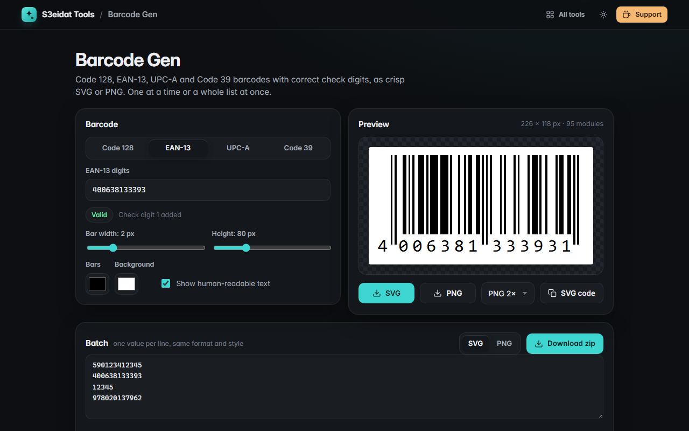

# Barcode Gen

> Code 128, EAN-13, UPC-A and Code 39 barcodes as SVG or PNG. Free, private, and it runs entirely in your browser.

### ▶ [Open Barcode Gen](https://s3eidat.github.io/barcode-gen/)



## Features

- **Code 128** with automatic subset B/C switching, so digit runs are packed tightly
- **EAN-13** and **UPC-A**: type 12 / 11 digits and the check digit is added, or type the full code and it is verified
  (a wrong check digit tells you the correct one)
- **Code 39** with an optional mod-43 check character
- Retail layout for EAN/UPC: long guard bars and digits placed under each half, like a real product barcode
- Bar width, height, colors and a human-readable text toggle
- Download **SVG** (vector, for print) or **PNG** at 1×, 2× or 4×, or copy the SVG code
- **Batch**: paste up to 1000 values, get a zip of SVG or PNG files; invalid lines are listed with the reason

All encoders are written from the specifications in plain JavaScript. No libraries.

## Privacy

Your values never leave your device. There is no server, no account, no analytics. The page ships with a strict
Content-Security-Policy (`connect-src 'self'`), so the browser itself blocks any attempt to send data anywhere.
Only your style settings are remembered in this browser.

## Run it yourself

It's plain HTML, CSS and JavaScript with no build step:

```bash
git clone https://github.com/s3eidat/barcode-gen
cd barcode-gen
python -m http.server 8000
```

Then open http://localhost:8000.

## Support

If this saved you time, **[buy me a coffee ☕](https://s3eidat.github.io/coffee/)**. It keeps every tool free.

---

Part of **[S3eidat Tools](https://s3eidat.github.io/)**: 100+ free, private tools that run in your browser. MIT licensed.
